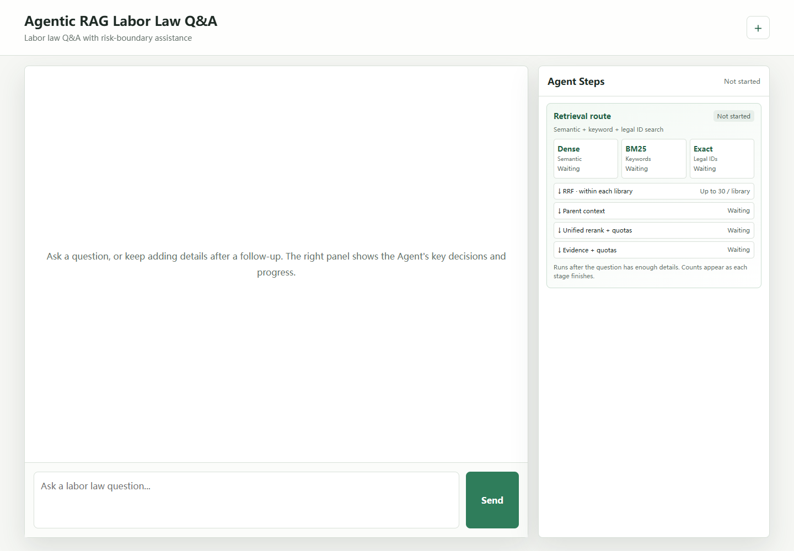
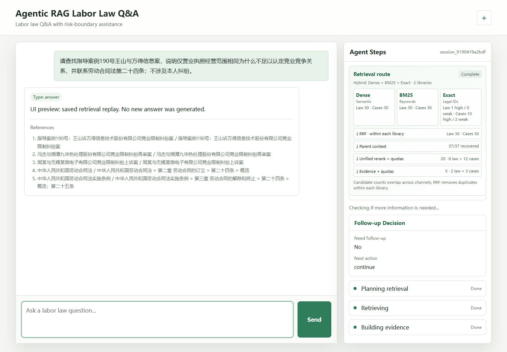

# 劳动法 Agentic RAG：混合检索（BM25 + 精确匹配 + RRF）消融实验与可视化报告

**记录日期**：2026-11-20  
**项目目录**：`G:\MSBD5018_agentic-rag-law-main`

---

## 1. 实验出发点：我们想解决什么问题？

### 1.1 从“选得好”走向“找得全、定得准”
在上一阶段的工作中（见 `report1.md`），我们完成了 **128 份中央法规**（511 个父块、1,384 个子块）与 **174 份劳动案例**（349 个父块、2,334 个子块）的双库接入，并通过“统一重排打分 + 两阶段来源配额（V4 策略）”解决了长篇案例挤占核心法条的问题，使最终综合召回率提升至 $0.8083$。

但配额机制本质上是“从已经找到的候选池里做席位分配”——**如果某条关键法条在最开始的向量初筛阶段就没有进入前 30 名，下游再精妙的配额也无米下炊。** 纯稠密向量检索（Dense Retrieval）虽然擅长理解口语语义，但在面对以下两类场景时存在天然短板：
1. **点名道姓的条号与案号定位**：例如用户直接提问 *“请解释《劳动争议司法解释（二）》第二十条”* 或 *“查找指导案例 182 号”*，向量模型会将整句话压缩为稠密数字，难以保证字面编号 $100\%$ 精确对齐。
2. **专有法律术语的字面匹配**：例如涉及“停工留薪期”、“责令限期支付”、“非全日制用工结算周期”等特定规范词项时，词法重合往往比宽泛的语义相似更直接。

为此，我们在本阶段按照项目计划书（Proposal）的设计路线，新增了 **中文 BM25 词法检索** 与 **结构化法规/案号精确匹配（Exact Match）** 两条初筛通道，在各自知识库内部通过 **倒数秩融合（RRF）** 合并后再送入下游重排器，检验多路混合检索能否在初筛源头带来净增益。

### 1.2 先算清底数：向量初筛到底漏了多少？
在动手加通道之前，我们先对上一轮双库基线的初始召回轨迹做了一次严格盘点，避免把“下游排位淘汰”误判为“源头没搜到”：
- 在 20 道诊断题的全部标准答案中，**双库纯向量初筛（每库 Top 30，共 60 个子块）其实只漏掉了 2 次法条父块（`q004` 的劳动报酬条款与 `q011` 的未参保工伤条款），案例父块则是 0 漏失，初筛综合覆盖率已高达 $95.00\%$！**
- 绝大多数残余失分（6 次法条、1 次案例）实际上是**已经进入了初筛池甚至前 20 名重排池，但在最终挑选 5 个父块时落选**。

看清这组底数非常关键：它意味着在 $95\%$ 的高起点上，新增检索通道不仅要尝试去捞那仅剩的 $5\%$ 疑难漏项，还必须**小心不能把向量原本已经找对的 $95\%$ 候选挤出每库 30 个席位的预算池**。

### 1.3 顺手打通前端“检索黑盒”
除底层检索实验外，原有网页右侧的 `Agent Steps` 面板在检索阶段只显示一个笼统的 `Retrieving` 状态，用户和开发者无法直观看到三路通道各自命中了多少条、来源配额究竟保留了几条法条与案例。因此，本阶段同步完成了前端 **混合检索实时路线面板（Retrieval route）** 的可视化改造。

---

## 2. 核心概念解读与递进实验设计

### 2.1 核心术语与评测指标说明
为便于理解本报告中的多路融合机制与评测口径，下表对新增的专业概念做通俗说明（基础父子块与真值定义沿用 `report1.md`）：

| 术语 / 指标 | 通俗含义 | 举例说明 |
| :--- | :--- | :--- |
| **稠密向量检索（`Dense`）** | 把问题和条文都转成 1,024 维向量，按**语义相近程度**找资料。 | 用户问“老板无故炒我鱿鱼”，即使没提专业术语，也能搜到“用人单位违法解除劳动合同”。 |
| **词法检索（`BM25`）** | 基于中文分词统计问题与条文的**关键词重合度**，越罕见的专业词撞上得分越高，同时平衡段落长度。 | 提问出现“非全日制”、“停工留薪”，包含这些精确词汇的法条会获得高分。 |
| **结构化精确匹配（`Exact`）与本条/引用区分** | 用规则精准识别问题点名的**法规名 + 条号**或**指导案例号/案号**，并严格区分**“本块就是该条（`high` 高置信）”**与**“正文只是顺带引用该条（`weak` 弱信号）”**。 | 搜“《劳动合同法》第 47 条”时，只有第 47 条原文算 `high` 享受保送席位；第 87 条正文里写“依照本法第 47 条……”只算 `weak`，绝不冒充本条抢占保送位。 |
| **库内倒数秩融合（`RRF`）** | 由于向量余弦分数（$0 \sim 1$）和 BM25 分数（可达十几分）量纲不同不能直接相加，RRF 改按各通道的**名次倒数**算总分：$\sum w_i / (60 + \text{rank}_i)$。 | 某法条在向量排第 2、在 BM25 排第 3，两边名次都靠前，融合后就会排在单科偏科的候选前面。 |
| **初筛合并池覆盖率（`Recall@Pool`）** | 法条库初筛 30 个子块 + 案例库初筛 30 个子块合并成 **60 个子块的初筛总池**后，标准答案被成功囊括进来的比例。 | 衡量检索“第一张大网”撒得准不准。如果标准答案没进这 60 条，后面重排再强也救不回来。 |
| **通道归属标签（`多路共现 / 独有`）** | 统计最终入选的 5 条父块证据最初是由哪条通道找来的：向量和 BM25 都搜到了叫**多路共现**，只有一方搜到叫**某路独有**。 | 用来观察新增的 BM25 通道是否真的把新面孔送进了最终证据包。 |

### 2.2 防误伤工程细节：保守分词与版本隔离
为防止词法与规则通道引入明显的工程噪声，我们在 `rag/lexical.py` 中落实了三道防线：
1. **保守停用词与条号归一化**：分词时仅剔除“您好、请问”等寒暄词与标点，**完整保留“不、未、尚未、没有、拒不”等决定法律性质的否定词**以及金额、期限与诉讼阶段词；同时将“第四十七条”与“第47条”统一补充规范词元 `art_47`，消除汉字与阿拉伯数字写法差异。
2. **简称消歧与多轮话题隔离**：采用最长匹配区分《劳动合同法》与《劳动合同法实施条例》，将“司法解释（二）”严格锚定至劳动争议司法解释全文；多轮对话切换新话题时，绝不把上一轮旧话题的案号或条号带入本轮精确匹配。
3. **预留上限控制**：在 M3 模式中，每库 30 个初筛名额最多为 `high` 精确命中预留 **5 个保送位**，其余 25 个席位仍由库内 RRF 排名补齐，不突破总预算。

### 2.3 三组递进对照组设计（M1 $\sim$ M3）
为了纯粹检验“初筛通道变化”带来的影响，我们将下游重排与证据选择策略**全部锁定为上一轮表现最好的 V4 双阶段配额策略**（代码与参数哈希保持不变），仅在初筛阶段设置三组递进对照：

| 实验组别 | 初筛策略（每库固定输出 30 个子块，两库共 60 个） | 下游固定策略（与上轮 V4 完全相同） | 设计目的（想检验什么假设？） |
| :--- | :--- | :--- | :--- |
| **M1 纯向量基线** | 仅使用 Qdrant 稠密向量检索 Top 30 | 60 条统一重排 $\rightarrow$ 按意图取 20 子块 $\rightarrow$ 按意图取 5 父块 | 复现上轮 V4 基准，作为评估混合检索增减益的严格参照线。 |
| **M2 向量 + BM25** | 向量 Top 30 + 中文 BM25 Top 30，在各库内按 $1:1$ 等权 RRF 融合取前 30 | 与 M1 完全相同 | 对比 M1，单独检验**引入中文 BM25 词法融合**后，能否补齐漏召回，或是否会稀释原有向量候选。 |
| **M3 完整三路混合** | 在 M2 基础上，加入结构化 `Exact`（`high` 最多预留 5 席，`weak` 按 $0.5$ 权重参与 RRF） | 与 M1 完全相同 | 对比 M2，单独检验**叠加法条号/案号精确匹配**在点名提问与防交叉引用误判上的实际作用。 |

---

## 3. 实验执行、核心结果分析与后续优化方向

### 3.1 环境对账与实验严谨性核验
实验继续采用与 `report1.md` 完全一致的 **20 道分层诊断测试题**，确保纵向可比。正式开跑前通过了四项严格核验：
- **云端与本地 3,718 点全量对账**：逐点比对本地 302 份 JSON 与云端 Qdrant 两个集合的全部 `3,718` 个子块（1,384 法条 + 2,334 案例），ID、父块关联与正文 $100\%$ 一致；进程内词法索引冷启动构建耗时 $4.10$ 秒，后续缓存命中仅需 $0.04$ 秒。
- **MySQL 860 父块零回退直读**：强制关闭本地 JSON 回退后，860 个父块全部由本机 MySQL 毫秒级回补（耗时 $0.02 \sim 0.04$ 秒）。
- **重排完整签名校验与基线对齐**：重排请求按查询词、有序候选文本与模型参数生成严格 SHA-256 签名，全部使用真实 API 打分（0 次异常回退）。重新真实打分的 **M1 在全部 20 题的初筛、重排、最终证据列表上与上一轮 V4 逐字一致**，证明下游管线零漂移。

### 3.2 核心结果总览：一个非常值得深思的“负向诊断信号”
下表汇总了 M1、M2、M3 在**初筛合并池（60 子块）**、**中间重排层（`Rerank@20`）**与**最终证据层（`Evidence@5`）**的核心指标表现：

| 评测阶段与维度 | 具体指标 | M1 纯向量 + V4 | M2 加入 BM25 | M3 再加 Exact | 核心变化与客观解读 |
| :--- | :--- | :---: | :---: | :---: | :--- |
| **第一关：初筛池** | 综合父块 `Recall@Pool` | **0.9500** | 0.9167 | 0.9167 | **不升反降（$-3.33\%$）**：等权 BM25 未捞回漏项，反而在初筛挤掉了 2 个正确法条 |
| **第一关：初筛排序** | 法条文档初筛 `MRR` | 0.6667 | 0.6901 | **0.7151** | **排序前移**：对于点名条号的题目，BM25 与 Exact 确实把目标法规顶到了更前排 |
| **第二关：子块重排** | `Rerank@20` 综合父块 Recall | **0.9500** | 0.9000 | 0.9000 | 初筛丢失的法条无法在重排恢复，且池子换血后多丢了 1 个法条父块 |
| **第三关：最终法条** | `Evidence@5` 法条父块 Recall | **0.7250** | 0.6500 | 0.6500 | 最终法条覆盖下降 $7.50\%$（损失全部集中在长篇口语化的“法律咨询”题） |
| **第三关：最终案例** | `Evidence@5` 案例父块 Recall | **0.8889** | **0.8889** | **0.8889** | 案例召回保持稳定，未受词法融合负面影响 |
| **第三关：最终综合** | `Evidence@5` 综合父块 Recall | **0.8083** | 0.7667 | 0.7667 | 当前默认参数下，混合检索整体表现低于纯向量 + V4 基线 |
| **证据通道构成** | 多路共现 : 向量独有 : BM25独有 | `0 : 100% : 0` | `61% : 25% : 14%` | `62% : 25% : 13%` | BM25 确实送进了 $13\% \sim 14\%$ 的新证据，但换入的并非标准答案核心法条 |

在科研与工程优化中，“加了模块指标却下降”往往比盲目涨分更能暴露底层机制的真实边界。结合逐题追踪账本，我们拆解出以下三大核心发现：

#### 发现一：为什么加入默认 BM25 反而掉了分？——“百字口语长句 + $1:1$ 等权融合”稀释了向量召回
分意图拆解表揭开了掉分的真正原因：在措辞规范的 5 道`法条解释`和 4 道`程序咨询`题上，M1、M2、M3 的最终法条召回率**全部稳居 $1.0000$（满分）**；**所有的退步 100% 发生在 8 道长篇口语化的`法律咨询`题上**（最终法条 Recall 从 $0.5625$ 跌至 $0.3750$）！
- **具体怎么挤掉的？** 在离线评测集中，为了不触发追问，每道`法律咨询`题都是长达百余字的当事人故事（包含大量诸如“在职 3 年、月薪 10000 元、人事负责人、书面保证、合作协议”等日常高频词）。评测脚本未经过大模型的检索词精炼改写，直接把整段口语长文原封不动喂给了 BM25。
- 当采用 **$1:1$ 等权重 RRF** 将 30 条向量候选与 30 条 BM25 候选压缩回 30 个席位时，那些恰好撞上日常背景词的次要法条在 BM25 中排名靠前，反过来把原本在向量检索第 $20 \sim 30$ 名擦线入围、语义真正对口的抽象核心法条（如 `q008` 学历欺诈解除案中的《劳动合同法》解除条款 `00002_p005`、`q014` 中的二倍工资条款 `00002_p008`）挤出了初筛 30 人名单！

#### 发现二：为什么叠加 Exact 召回率持平？——机制精准生效，但与高水平基线覆盖重叠
表面上看 M3 与 M2 的召回率数字相同，但审查内部预留日志可以确认，**结构化 Exact 的“本条保送 + 交叉引用拦截”机制完全按设计精准工作**：
- 在全部 10 道包含明确条号或指导案例号的题目（`q025` $\sim$ `q060`）中，Exact 均准确锁定了目标原文并触发高置信预留，将初筛法条文档 `MRR` 从 M1 的 $0.6667$ 推高至 **$0.7151$**。
- **典型防误伤实例（`q060` 指导案例 190 号竞业限制案）**：案例库中另一份判决书 `(2025)苏02民终1980号`（子块 `50036_c039`、`c040`）在正文中引用了“指导案例 190 号”。Exact 解析器准确识别出它并非 190 号本案，将其降级为 `weak` 且不给预留位（`reserved=False`），只将真正的 190 号本案（`50074`）和《劳动合同法》第 24 条（`00002_c013`）列为 `high` 保送。
- 之所以没有带来额外的 Recall 涨幅，是因为对于这批点名道姓的题目，原有的向量检索与 BM25 本身就已经实现了 $100\%$ 初筛召回，没有留下需要靠 Exact“从无到有”救回的死角。

#### 发现三：对比 `q004` 与 `q057`，看清“单轮初筛”无法解决的真正瓶颈
报告重点追踪了同样涉及“不走审批拒发年终奖（对应《劳动合同法》第 30 条 `00002_p004` + 指导案例 182 号 `50071_p001`）”的两道关联题，揭示了两类截然不同的深层瓶颈：
1. **跨概念词汇鸿沟（`q004`）**：用户只说口语化的“奖金一直不走审批”，既没提法条号，也没出现法条原文里的“劳动报酬”四个字。结果无论向量、BM25 还是 Exact，三路初筛都没能捞回第 30 条（`False`），而指导案例 182 号又在最后一步被硬配额挤出。
2. **多需求席位竞争（`q057`）**：该题明确点名“检索指导案例 182 号并说明工资支付法条依据”，第 30 条顺利闯过了初筛池（`True`）和 20 条重排（`True`），但在最终 `案例检索` 配额（仅留 2 个法条席位）下排在第 3 个法条位而惜败落选（`False`）。

### 3.3 前端可视化改进成果：混合检索路线透明可见
为配合混合检索架构落地，我们在网页端右侧 `Agent Steps` 区域新增了固定可见的 **Retrieval route** 实时状态面板（沿用英文界面与绿色主题风格），通过 SSE 流式事件实时展示真实执行轨迹：
- **全链路真实计数**：依次动态更新 `Dense`、`BM25`、`Exact（区分 high / weak 命中数）` $\rightarrow$ `库内 RRF 去重保留数` $\rightarrow$ `MySQL 父块回补进度` $\rightarrow$ `统一重排 20 子块配额结果` $\rightarrow$ `最终 5 父块法条/案例构成`。所有数字均取自后端真实回调而非固定占位符。
- **完备的状态反馈**：清晰区分未开始（`Not started`）、等待追问补充事实（`Awaiting details`）、通道关闭（`Not enabled`）以及异常回退（`Used fallback`），并在桌面端（1440px）与移动端（390px）通过了无新增 API 费用的真实数据回放验证。

**界面运行效果示意：**

- 初始等待状态：



- 真实检索记录回放后的状态：




### 3.4 总结结论与下一步优化方向
本次实验客观证明：**在纯向量初筛已达 $95\%$ 覆盖率的前提下，直接将未改写的长口语提问按 $1:1$ 等权重接入 BM25 会稀释向量主干候选，导致最终综合 Recall 从 $0.8083$ 回落至 $0.7667$**（因此评测对比上当前纯向量 `dense` 仍是更稳健的参照，代码中保留了模式一键切换开关）。这一诊断为我们指明了接下来最具针对性的三步改进路线：

1. **修正混合初筛策略：“保护向量主干 + 精炼改写词输入”**
   - **锁住向量主干防退步**：不再将 30 个向量候选全部打散重排，而是改为每库 **`最多 5 席高置信 Exact 保送` + `优先锁住 Dense Top 20 主干不淘汰` + `剩余席位由降权后的 BM25/RRF 补位`**，从机制上杜绝 `q008`、`q014` 这类“把已找对的法条挤出局”的负迁移。
   - **通道输入各司其职**：向量通道继续接收语义完整的问句，而 BM25 通道改为仅接收问题理解模块提炼出的**规范法律改写词（`rewritten_query`）**，剥离长篇日常叙事噪声。
2. **引入核心 Agent 机制：“证据覆盖检查与定向补检（Evidence Coverage Check）”**
   - 针对 `q004`（跨概念漏召回法条）和 `q057`（多诉求挤掉配套法条）这类单轮初筛难以兼顾的复杂问题，按 Proposal 第 3.4 节设计，在首轮构建 5 条证据后、生成答案前，由 Agent 将问题拆解为独立**信息需求（Information Needs）**并按三档评分检查当前证据是否覆盖；一旦发现某项子诉求缺乏依据（如“有了奖金案例，但缺工资支付法条”），自动生成针对性的精炼补充查询词触发 **至多 1 轮定向补检**。
3. **结合相关性“软保底”消除无效占位**
   - 为最终证据配额增加最低重排相关性门槛，当某一来源候选得分过低时自动让出预留席位，避免无关法条硬挤掉高分指导案例。

---

## 4. 涉及的新增与修改文件清单（供团队复现参考）

以下汇总本阶段在混合检索后端、离线评测以及前端可视化三部分新增或修改的全部文件路径，便于小组成员同步代码与复现验证。

### 4.1 混合检索后端与离线评测文件

| 文件／目录（完整路径） | 状态 | 作用 |
| --- | --- | --- |
| `G:\MSBD5018_agentic-rag-law-main\rag\lexical.py` | 新增 | 法规／案例标识解析、本条与交叉引用区分、保守分词、BM25、进程级指纹缓存、库内融合及进度回调 |
| `G:\MSBD5018_agentic-rag-law-main\rag\schemas.py` | 修改 | 新增 `raw_query`、`retrieval_mode` 及各检索通道独立分数字段 |
| `G:\MSBD5018_agentic-rag-law-main\rag\retrieval.py` | 修改 | 抽离 `initial_candidates` 与 `enrich_parents`，支持 `dense` / `dense_bm25` / `hybrid` 三模式切换、安全回退与进度推送 |
| `G:\MSBD5018_agentic-rag-law-main\rag\skill_router.py` | 修改 | 保存当前轮用户原话 `raw_query`，支持模式配置（线上默认 `hybrid`），原两阶段配额不变 |
| `G:\MSBD5018_agentic-rag-law-main\rag\workflow.py` | 修改 | 增加初筛、回退调试记录及检索实时进度事件推送，继续传递原 V4 证据配额 |
| `G:\MSBD5018_agentic-rag-law-main\rag\providers.py` | 修改 | 将重排请求体提取为 `request_parameters()`，确保缓存签名与真实请求参数严格一致 |
| `G:\MSBD5018_agentic-rag-law-main\requirements.txt` | 修改 | 新增中文分词依赖 `jieba==0.42.1` |
| `G:\MSBD5018_agentic-rag-law-main\eval\preflight_hybrid.py` | 新增 | 302 份 JSON 语料指纹校验、3,718 点云端 Qdrant 只读全量对账、MySQL 禁回退核验、上轮初始召回审计 |
| `G:\MSBD5018_agentic-rag-law-main\eval\run_hybrid_m123.py` | 新增 | 20 题 M1/M2/M3 三组实验运行、完整有序请求 SHA-256 签名缓存、断点续跑及多轮路由检查 |
| `G:\MSBD5018_agentic-rag-law-main\eval\test_hybrid_lexical.py` | 新增 | 覆盖本条/引用区分、无名条号降级、别名版本、否定词、BM25 边界及签名敏感性的 13 项离线单元测试 |
| `G:\MSBD5018_agentic-rag-law-main\eval\report_hybrid_m123.py` | 新增 | 从落盘排名数据离线复算全部指标与逐题双向账本，不调用外部 API |
| `G:\MSBD5018_agentic-rag-law-main\eval\results_hybrid_20` | 新增 | 保存前置对账记录、M1–M3 完整结果、真实评分缓存、通道归属及逐题父块轨迹 |
| `G:\MSBD5018_agentic-rag-law-main\Refinement and Optimization\report_hybrid_m123.md` | 新增 | 混合检索实验与前端改进原始详细归档记录 |

### 4.2 前端混合检索可视化新增／修改文件

| 文件／目录（完整路径） | 状态 | 作用 |
| --- | --- | --- |
| `G:\MSBD5018_agentic-rag-law-main\templates\index.html` | 修改 | 在右侧 Agent Steps 中增加固定可见的 `Retrieval route` 混合检索路线面板，为静态资源增加版本参数 |
| `G:\MSBD5018_agentic-rag-law-main\static\app.js` | 修改 | 监听 SSE `retrieval_progress` 事件，动态更新各通道命中数、配额保留数、异常状态与新会话重置逻辑 |
| `G:\MSBD5018_agentic-rag-law-main\static\style.css` | 修改 | 新增三路通道卡片、融合流程节点、运行／完成／回退状态配色及移动端响应式布局样式 |
| `G:\MSBD5018_agentic-rag-law-main\app.py` | 修改 | 注册 `retrieval_progress` 展示标签并沿用现有 SSE 通道向前端流式推送 |
| `G:\MSBD5018_agentic-rag-law-main\eval\verify_retrieval_ui.py` | 新增 | 复用真实检索缓存与本机 MySQL，自动化验证 Flask SSE 接线及桌面／移动端浏览器渲染状态 |
| `G:\MSBD5018_agentic-rag-law-main\Refinement and Optimization\images\hybrid_retrieval_idle.png` | 新增 | 混合检索路线面板初始待机状态页面截图 |
| `G:\MSBD5018_agentic-rag-law-main\Refinement and Optimization\images\hybrid_retrieval_complete.png` | 新增 | 混合检索路线面板真实检索记录回放完成状态页面截图 |

### 4.3 团队快速复现与验证命令参考

在项目根目录下使用已配置好的 `.venv` 虚拟环境与 `MySQL84LawRag` 服务，可按需执行以下命令：

```powershell
Set-Location "G:\MSBD5018_agentic-rag-law-main"

# 1. 运行全部离线单元测试（共 28 项，不消耗 API 费用）
.\.venv\Scripts\python.exe -X utf8 -m unittest discover -s eval -p "test_*.py"

# 2. 基于已有真实缓存零费用复现 M1/M2/M3 三组实验与汇总（需本机 MySQL 运行）
.\.venv\Scripts\python.exe -X utf8 eval\run_hybrid_m123.py --replay
.\.venv\Scripts\python.exe -X utf8 eval\report_hybrid_m123.py

# 3. 启动网页服务查看右侧混合检索实时可视化面板（浏览器打开 http://127.0.0.1:5000 后按 Ctrl+F5 强刷）
.\.venv\Scripts\python.exe -X utf8 app.py
```