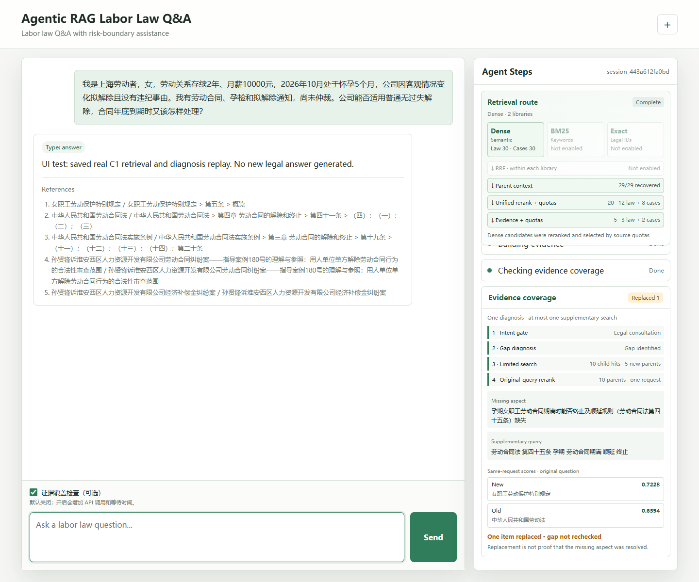
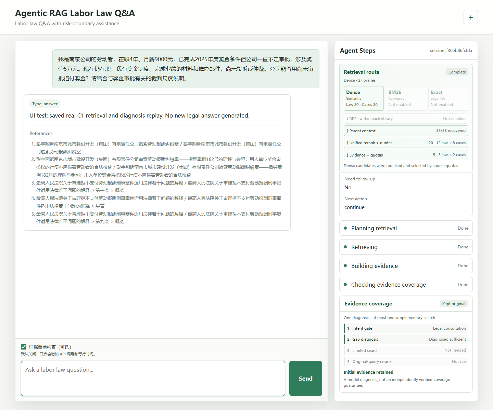
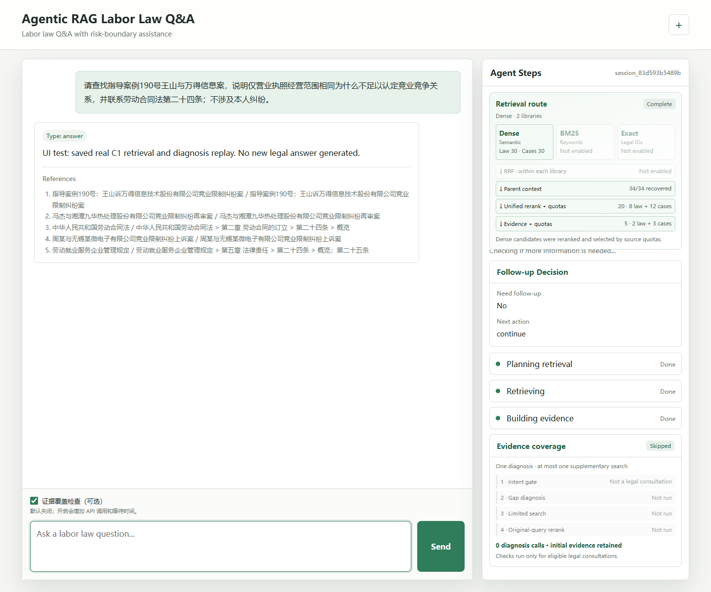
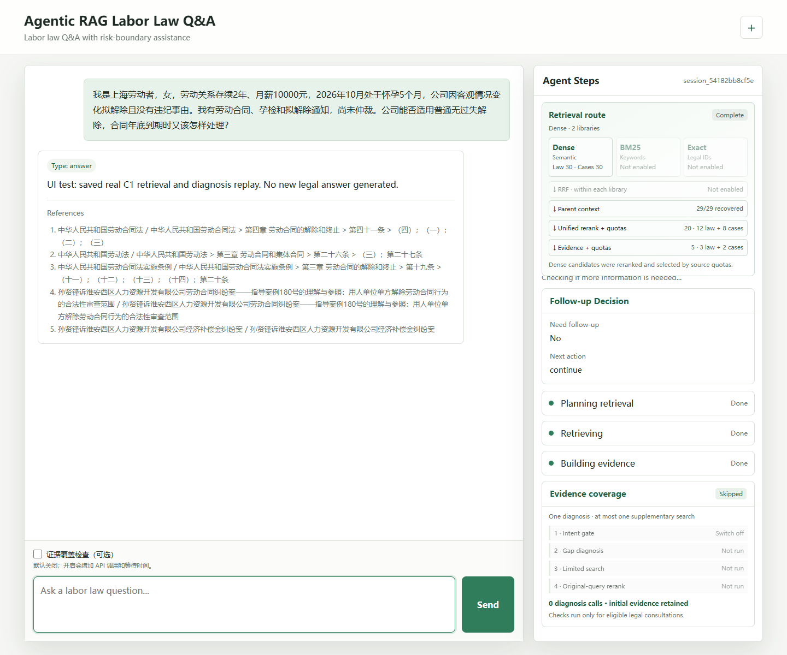

*Note: the links and images in this document may point to external sources. Please review them before opening.*

# 劳动法 Agentic RAG：轻量证据缺口诊断与单轮补检报告

**记录日期**：2026-11-20  
**项目目录**：`G:\MSBD5018_agentic-rag-law-main`

---

## 1. 实验出发点：我们想解决什么问题？

### 1.1 前两阶段回顾与最后一块拼图
在前两阶段的优化中，我们先后完成了 **174 份劳动案例入库与两阶段来源配额（`report1.md`）**，以及 **BM25 + 精确匹配 + RRF 混合检索诊断（`report2.md`）**。实测表明，`Dense（纯向量）+ V4 两阶段来源配额` 在 20 道诊断题上的最终综合召回率达到 **$0.8083$**，优于默认等权混合检索（$0.7667$）。因此，我们将线上默认初筛模式切回更稳健的 `dense`（保留混合模式可选），并把目光投向检索链路的最后一环：

> *当首轮检索已经选出 5 条父块证据后，如果面对包含多个子诉求的复杂咨询，系统能否在生成答案前自动发现“还缺哪块关键依据”，并用极小的代价补搜一次？*

### 1.2 面向工程落地的轻量化取舍（与 Proposal 原设想的差异说明）
在项目初期的 Proposal 设想中，证据覆盖检查（Evidence Coverage Check）计划将每个问题拆解为不限数量的子信息需求，再由模型对“每个子需求 $\times$ 每条候选片段”逐一进行三档支持度打分（Strong / Partial / Unsupported），最后针对缺口发起补检。

考虑到项目整体工作量边界、代码复杂度以及在线问答对响应延迟与 API 成本的实际约束，**本阶段没有照搬沉重的“需求—片段全矩阵打分”，而是实现了一套职责清晰的轻量化简化方案**：

```text
意图门禁过滤 ──▶ 单次整体缺口诊断 ──▶ 单轮受限补检 ──▶ 原问题统一重排与单条替换
```

简化方案的核心设计思路如下：
1. **先过门禁再诊断**：仅对案情复杂的“法律咨询”开放检查；法条解释、程序咨询与案例检索直接免检放行，避免简单问题承担额外延迟。
2. **整体诊断替代矩阵打分**：复用回答生成模块实际可见的证据文本（含命中子块摘录），仅调用 1 次大模型输出结构化 JSON，判断“回答核心问题所必需的依据是否明显缺失”；同时**不强制要求每道题凑齐法条和案例**，若现有成文法已足够解答，缺少案例不视为缺口。
3. **统一重排解决跨查询分数不可比**：若存在真实缺口，最多生成 1 条短查询补搜（单库上限 10 子块，双库合计上限 20 子块）。回补并剔除已有父块后，将至多 5 个新父块与原 5 条证据合并，**统一针对用户的原始问题重新打分一次**，仅在最高分新证据严格优于同来源末位旧证据时替换 **最多 1 条**，杜绝“拿补检词的高分强行顶替原问题证据”的口径错位。

---

## 2. 核心概念解读与对照实验设计

### 2.1 核心术语与机制说明
为方便快速理解本阶段新增的 Agent 闭环机制与统计口径，下表对关键概念做通俗说明：

| 术语 / 机制 | 通俗含义 | 举例说明 |
| :--- | :--- | :--- |
| **意图门禁（`gate_skipped`）** | 覆盖检查的“准入收费站”。非个案咨询题或关闭开关时直接跳过，记为 `gate_skipped`，产生 **$0$ 次**额外模型调用。 | 用户问“劳动合同法第 19 条试用期怎么规定”，属于纯法条解释，系统直接跳过检查进入作答。 |
| **生成输入对齐** | 诊断模块看到的证据内容，与后续回答大模型看到的文本**一字不差**（直接复用 `format_evidence_text`），不另行截取前 240 字。 | 若某长父块因长度限制只展示了前 3 个命中子块摘录，诊断模型就基于这份真实可见文本判断缺口。 |
| **单轮受限补检** | 诊断发现缺口后，自主生成 **1 条**针对性短查询去法条库或案例库捞人，严格限制新增子块数且**绝不递归二次补检**。 | 咨询孕期辞退与年底合同到期时，若发现缺“到期顺延”条文，自动生成短查询去法条库补捞前 10 条子块。 |
| **原问题统一重排与同源替换** | 把新捞出的候选父块（去重后至多 5 个）和原来的 5 个父块放在一起，**统一按用户最初的完整问题重排打分**，优先在同类来源（法条换法条、案例换案例）中淘汰最低分旧项，最多换 1 条。 | 新捞出的女职工保护法规得 $0.7228$ 分，高于原证据包里垫底的法条（$0.6594$ 分），则完成 1 对 1 替换。 |
| **综合父块 `Recall@5` 与 `MRR`** | **`Recall@5`**：最终 5 条证据覆盖了多少标准答案要求的核心段落；**`MRR`**：第一条正确依据排名的倒数均值（第 1 名得 $1.0$，第 2 名得 $0.5$）。 | 某题标准依据仍在 5 条内，`Recall@5` 保持 $1.00$；但若排名从第 1 掉到第 2，单题 `MRR` 会降为 $0.50$。 |
| **未复核标记（`gap not rechecked`）** | 发生单条替换后，系统不再花钱做第二轮诊断，界面如实提示“已替换但未二次复核缺口”，不把“执行了补检”夸大为“缺口必定解决”。 | 前端步骤卡展示新旧重排对比分数的同时，保留客观边界提示。 |

### 2.2 对照实验设计（`C0` vs `C1`）
为了纯粹衡量“增加一轮轻量覆盖检查与补检”带来的真实收益与开销，我们在完全相同的 20 道分层诊断题（8 道法律咨询、5 道法条解释、4 道程序咨询、3 道案例检索）上对比以下两组配置：

| 实验组别 | 首轮检索与证据基础 | 覆盖检查与补检策略 | 设计目的（想检验什么问题？） |
| :--- | :--- | :--- | :--- |
| **C0 基线组（关闭检查）** | 直接复用已锁定的 `M1（Dense + V4）` 首轮 5 条证据 | **关闭**（$0$ 次诊断、$0$ 次补搜） | 作为固定参照基准，代表不花额外 API 预算时的证据覆盖与排名水平。 |
| **C1 实验组（开启检查）** | 与 C0 逐题完全相同的首轮 5 条证据 | **开启**（过意图门禁 $\rightarrow$ 诊断 $\rightarrow$ 按需单轮补检与统一重排替换） | 单变量检验轻量补检能否捞回首轮遗漏依据，同时量化新增的调用次数与等待耗时。 |

*注：实验前通过 SHA-256 严格锁定首轮结果与题库真值；本机 MySQL 860 个父块经强制禁回退核验 100% 直读成功；诊断提示词仅接收问题与当前可见证据，绝不泄露任何人工真值 ID 或预设搜索词。*

---

## 3. 实验结果、核心洞察与工程收尾调整

### 3.1 实测数据总览
实验全流程无任何接口或解析异常（`check_failed = 0`）。C0 与 C1 在全部 20 题及 8 道受检法律咨询题上的表现对比如下：

| 评测维度 / 运行统计 | C0 全 20 题 | C1 全 20 题 | C0 咨询 8 题 | C1 咨询 8 题 | 结果解读 |
| :--- | :---: | :---: | :---: | :---: | :--- |
| **法条父块 `Recall@5`** | 0.7250 | 0.7250 | 0.5625 | 0.5625 | 保持不变，未挤丢原有正确法条，也未新增命中标注法条 |
| **案例父块 `Recall@5`（非空题）** | 0.8889 | 0.8889 | 0.8333 | 0.8333 | 保持不变，同源替换规则未破坏案例席位 |
| **综合父块 `Recall@5`** | **0.8083** | **0.8083** | **0.6667** | **0.6667** | **20 题全部持平（改善 0 / 持平 20 / 退步 0）** |
| **综合父块 `MRR`** | **0.9250** | 0.9000 | **0.8125** | 0.7500 | 因单题（`q024`）新换入法规排至榜首，原核心法条退居第 2 名 |
| **综合父块 `Hit@5`** | 0.9500 | 0.9500 | 0.8750 | 0.8750 | 至少命中一项依据的题数比例完全一致 |
| **门禁跳过 / 实际诊断题数** | — / 0 | **12 / 8** | — / 0 | **0 / 8** | 门禁精准拦截 12 道非咨询题（在本集中省去 $60\%$ 诊断请求） |
| **触发补检 / 实际替换题数** | 0 / 0 | **1 / 1** | 0 / 0 | **1 / 1** | 8 次诊断中 7 题判充分，仅 `q024` 触发真实补搜并完成替换 |
| **新增模型调用总次数** | 0 | **10 次** | 0 | **10 次** | 含 8 次 DeepSeek 诊断 + 1 次 Embedding + 1 次统一 Rerank |
| **平均增量耗时（秒 / 题）** | 0.00 | +3.44 s | 0.00 | **+8.60 s** | 受检咨询题平均每题多等待约 $8.6$ 秒 |

### 3.2 深度洞察：为什么“证据覆盖检查”未必有效，甚至可能只增加 API 开销？
一个非常值得写进项目总结的客观发现是：**在本次实验中，完整的补检闭环跑通了，但综合 `Recall@5` 零增长，`MRR` 微降 $0.0250$，同时多付出了 10 次模型调用与近 69 秒累计等待。** 这证实了在 RAG 系统中“叠加反思循环并不天然带来正收益”，结合真实个案轨迹，背后的原因主要有三点：

1. **高基线下的“固定检查税”与窄边际空间**  
   当首轮 `Dense + V4` 的综合覆盖率已经达到 $0.8083$（`Hit@5` 达 $95\%$）时，绝大多数问题首轮找回的资料已经够用。但只要开启覆盖检查，**每一道**进入门禁的咨询题都必须先交一笔固定的“阅读诊断税”（本集 8 题均需调用大模型通读 5 份长证据，7 题读完后仅确认无需操作），导致确定性的 API 与延迟开销远大于偶发的补检收益。
2. **“次优证据”制造充分性幻觉，导致真正缺依据的题漏报（如 `q004`）**  
   在 `q004`（公司拖延审批拒发 5 万元年终奖案）中，首轮证据包其实漏掉了标注的《劳动合同法》第 30 条与指导案例 182 号（真值 `Recall@5 = 0`）。然而，首轮包里已有其他普通奖金纠纷判例和一般规定，大模型在单次整体诊断时认为“手头材料已经足够组织出合理回答”，返回 `sufficient=True` 放行。这说明**当存在表面相关的次优材料时，粗粒度整体诊断极易产生“够用幻觉”，漏掉真正需要补救的隐蔽缺口**。
3. **“展示截断去重”与“原问题主诉求虹吸”使补检擦肩而过（如 `q024`）**  
   在唯一触发补检的 `q024`（怀孕 5 个月拟被无过失解除 + 合同年底到期如何处理）中，诊断模型表现极其敏锐：虽然包含第 42 条和第 45 条的长父块 `00002_p005` 已被首轮命中，但因证据构建截断未展示后半段的“第 45 条合同期满顺延”，模型一眼看穿缺口并自主生成了精准补检词 `劳动合同法 第四十五条 孕期 劳动合同期满 顺延 终止`。但随后发生了两重碰撞：
   - **去重拦截**：补检搜回的第 45 条子块仍归属已有父块 `00002_p005`，按父块 ID 去重规则被直接剔除，未能刷新原父块的可见摘录；
   - **主诉求虹吸**：在剩余新候选中，真正讲合同续延的条文（`20008_p009`）在**针对原始长问题统一重排**时，败给了通篇讲孕期保护不得辞退的《女职工劳动保护特别规定》（`20007_p006`，$0.7228$ 分 > 旧末位法条 $0.6594$ 分）。最终替换进来的新证据迎合的是原问题篇幅最大的“孕期解除”主诉求，而非刚才诊断出的“到期顺延”小缺口，还顺带把原排第 1 的 `00002_p005` 挤到了第 2 名（单题 `MRR` 从 $1.00$ 降至 $0.50$）。

### 3.3 前端可视化与工程收尾决策：改为“默认关闭、按需开启”
基于上述实测结论——**不应为了保留功能演示而让每一次日常提问无条件承担额外的 API 费用与延迟**，我们在收尾阶段完成了两项务实的工程调整：

1. **右侧四阶段实时可视化卡片**：在网页 `Agent Steps` 面板新增了 **意图门禁 $\rightarrow$ 整体缺口诊断 $\rightarrow$ 单轮受限补检 $\rightarrow$ 原问题统一重排** 状态卡，实时推送补检词、新增候选数、新旧同口径对比分数及 `gap not rechecked` 客观提示。
2. **前后端统一改为“常态默认关闭，界面一键开启”**：将后端 `enable_coverage_check` 默认值设为 `False`，并在网页输入框上方新增可选勾选框 **“证据覆盖检查（可选）”**。日常使用保持零额外诊断开销、直接运行稳健的 `Dense + V4` 主链路；遇到多诉求复杂疑难咨询或进行系统演示时，用户只需手动勾选即可完整体验自动诊断与补检闭环。

**浏览器真实缓存回放验证截图：**

- **图 1：手动开启后，`q024` 触发单轮补检并完成同源替换**（新候选 `0.7228` 大于旧末位 `0.6594`，并提示缺口未经二次复核）：



- **图 2：手动开启后，`q004` 诊断判定充分，保留原证据包**（不执行补检与重排）：



- **图 3：手动开启后，`q060` 被意图门禁自动跳过**（非法律咨询题，$0$ 次诊断调用）：



- **图 4：默认关闭状态**（日常提问零额外诊断调用，完整保留首轮证据）：



### 3.4 后续可选改进方向
若未来在更大规模盲测中进一步打磨覆盖检查模块，可优先探索三个精细化方向：① 允许同父块新命中的子块直接刷新原父块的展示摘录（解决 `q024` 截断盲区）；② 在替换阶段结合“缺口查询相关性”而非仅看“原问题整体相关性”选拔新证据；③ 引入细粒度子需求拆解以降低 `q004` 式的次优满足漏报。

---

## 4. 涉及的新增与修改文件清单（供团队复现参考）

以下完整列出本阶段新增与修改的代码、测试及数据目录路径，便于小组成员查阅与独立复现（共 44 项离线单元测试全部通过）。

### 4.1 本轮新增／修改文件总表

| 完整路径 | 改动与用途 |
| --- | --- |
| `G:\MSBD5018_agentic-rag-law-main\rag\coverage.py` | 新增：整体诊断、受限补检、统一重排及单条替换 |
| `G:\MSBD5018_agentic-rag-law-main\rag\answer.py` | 修改：公开共享证据格式化函数，原私有别名仍兼容 |
| `G:\MSBD5018_agentic-rag-law-main\rag\schemas.py` | 修改：`RetrievalPlan.enable_coverage_check` 默认 `False` |
| `G:\MSBD5018_agentic-rag-law-main\rag\skill_router.py` | 修改：默认 `dense`；覆盖开关默认 `False`，仍可显式开启 |
| `G:\MSBD5018_agentic-rag-law-main\rag\workflow.py` | 修改：`run` 及 `run_agentic_rag` 接收默认关闭的开关；保留实时 SSE 和 `debug` |
| `G:\MSBD5018_agentic-rag-law-main\app.py` | 修改：普通／流式接口传递布尔开关，省略默认 `False`，非法值返回 400 |
| `G:\MSBD5018_agentic-rag-law-main\static\app.js` | 修改：四阶段卡片；随请求发送勾选值，执行中锁定开关，新会话恢复关闭 |
| `G:\MSBD5018_agentic-rag-law-main\static\style.css` | 修改：覆盖卡片、分数对照及开关样式 |
| `G:\MSBD5018_agentic-rag-law-main\templates\index.html` | 修改：输入框上方增加默认关闭的可选开关、费用提示及资源版本 |
| `G:\MSBD5018_agentic-rag-law-main\eval\test_coverage_light.py` | 新增：16 项测试，含两 API 默认关闭、主动开启与非法参数拒绝 |
| `G:\MSBD5018_agentic-rag-law-main\eval\run_coverage_light.py` | 新增：锁定 M1／题目、C0 零调用、真实 C1、缓存与断点恢复 |
| `G:\MSBD5018_agentic-rag-law-main\eval\report_coverage_light.py` | 新增：按保存证据离线重算报告与得失账本 |
| `G:\MSBD5018_agentic-rag-law-main\eval\test_hybrid_lexical.py` | 修改：跟随线上默认 `dense`，继续验证 `hybrid` 可选 |
| `G:\MSBD5018_agentic-rag-law-main\eval\verify_retrieval_ui.py` | 修改：原混合检索 UI 回放显式选 `hybrid` 并关闭本轮检查 |
| `G:\MSBD5018_agentic-rag-law-main\eval\verify_coverage_ui.py` | 新增：缓存＋SSE＋MySQL 回放，验证默认关闭／主动开启并生成 4 张截图 |
| `G:\MSBD5018_agentic-rag-law-main\eval\results_coverage_20` | 新增：C0／C1、逐题检查点、请求缓存、事件、输入哈希及分析 |
| `G:\MSBD5018_agentic-rag-law-main\Refinement and Optimization\report3.md` | 新增：本收官报告 |

### 4.2 最小复现命令参考

在项目根目录下执行离线回归测试、缓存回放与网页启动：

```powershell
Set-Location "G:\MSBD5018_agentic-rag-law-main"

# 1. 运行全部离线单元测试（共 44 项）
.\.venv\Scripts\python.exe -X utf8 -m unittest discover -s eval -p "test_*.py"
.\.venv\Scripts\python.exe -X utf8 -m unittest discover -s scripts -p test_mysql_setup.py

# 2. 运行覆盖检查实验（支持缓存复用 --replay）与离线重算报告
.\.venv\Scripts\python.exe -X utf8 eval\run_coverage_light.py --replay
.\.venv\Scripts\python.exe -X utf8 eval\report_coverage_light.py

# 3. 启动网页服务（默认关闭覆盖检查，可在输入框上方手动勾选开启）
.\.venv\Scripts\python.exe -X utf8 app.py
```